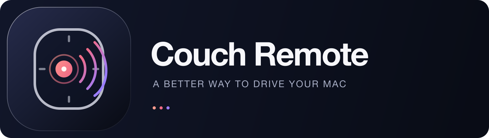
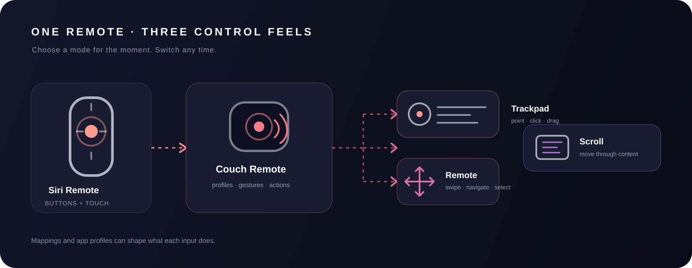
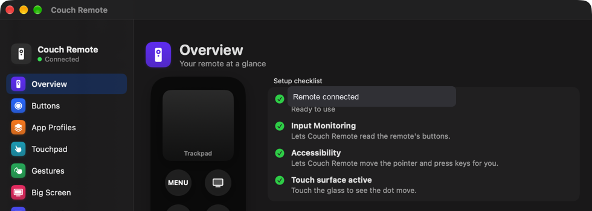
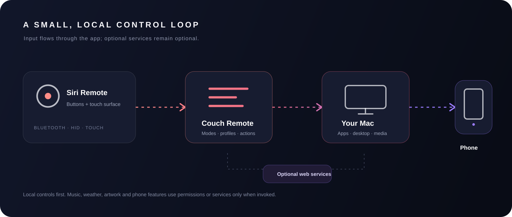

<!-- Replace YOUR-USERNAME/YOUR-REPOSITORY with the final GitHub path before publishing. -->
<div align="center">
  
  <br />
  <p><strong>Make the first-generation Apple TV Siri Remote feel at home on your Mac.</strong></p>
  <p>
    
    
    
    
  </p>
  <p><a href="Wiki/Home.md">Explore the Wiki</a> · <a href="CONTRIBUTING.md">Contribute</a> · <a href="SECURITY.md">Security</a></p>
</div>

> Couch Remote is an independent community project—not affiliated with or endorsed by Apple. It uses private macOS APIs for the remote’s touch surface; OS updates can affect that functionality.

---

## One remote. Three ways to move.

A Siri Remote can be a precise pointer, a directional clickpad, or a one-finger scroller. Choose the feel that fits the app, then customize buttons and gestures around it.

<div align="center">
  
</div>

## The controls, at a glance

| Trackpad | Remote | Scroll |
|:--|:--|:--|
| Move and click the Mac pointer; tune tap, drag, and precision behavior. | Swipe, tap, and click the glass as directional navigation. | Scroll through pages and long lists with touch movement. |

**Make it yours:** map buttons and gestures, switch behavior for individual apps with profiles, and adjust the touch surface until it feels right.

## Built for the couch

- **Big Screen** — a full-screen, remote-first home with widgets, Apple Music/TV browsing, search, files, apps, playlists, watch shortcuts, and Now Playing.
- **Couch Menu & keyboard** — quick navigation and text entry without reaching for a separate keyboard.
- **Media controls** — play/pause, previous/next, web-video actions, and Now Playing details when macOS provides them.
- **Built-in YouTube window** — a WebKit TV-style interface; web-service behavior can change.
- **Phone remote (optional)** — use a browser on the same trusted Wi-Fi; no companion app needed.
- **Useful extras** — sleep timer, spotlight, drawing/presenter overlays, HUD, battery and optional calendar/weather widgets.

<div align="center">
  
  <br />
  <sub>Settings overview · remote and privacy status at a glance.</sub>
</div>

## How it fits together

<div align="center">
  
</div>

## Get it running

### Requirements

- Mac running **macOS 13 Ventura or later**.
- **Xcode Command Line Tools** (`swiftc` and the macOS SDK); full Xcode is not required by the build script.
- **Apple TV Siri Remote, 1st generation**, paired through Bluetooth. Other generations and third-party remotes are not guaranteed.

### Build from source

```sh
# If needed, install Apple's command line tools once:
xcode-select --install

# From the repository root:
bash build.sh
open "build/Couch Remote.app"
```

The bundle is created at `build/Couch Remote.app`. The script builds for the host architecture, targets macOS 13, and ad-hoc signs the app for local use. It is **not notarized** or distributed through the Mac App Store. The build script includes the project icon from `Assets/Brand/CouchRemote.icns`. The shell script is the supported build path; this repository does not currently include an Xcode project or third-party package dependencies.

### First launch

1. Pair the remote in **System Settings → Bluetooth**. The app’s Overview includes the pairing hint (hold **Menu + Volume Up**, then connect in Bluetooth settings).
2. Grant **Input Monitoring** so Couch Remote can read button presses.
3. Grant **Accessibility** so it can move/click the pointer and send navigation keys.
4. Approve optional macOS Automation prompts for Music/TV; calendar access is only needed for the calendar widget; local-network access is only needed for the phone remote.

Permissions may need to be granted again after changing the app’s location or signature. If input stops working, check **System Settings → Privacy & Security** and reopen the app.

## Repository map

```text
.github/             issue templates, PR template, macOS build workflow
Assets/              original logo, editable SVG diagrams, README imagery
Sources/             Swift app source, compiled together by build.sh
Support/             C declarations for private multitouch structures
Wiki/                detailed guides, troubleshooting, and publishing checklist
build.sh             compile and package Couch Remote.app
```

The GitHub Actions workflow verifies compilation and uploads a short-lived development artifact. **A green build is not hardware validation:** CI cannot test a paired Siri Remote, permissions, music playback, or every display layout.

For publishing steps and the Wiki tab, see [Wiki → Repository checklist](Wiki/Repository-Checklist.md). Feature guides live in the [Wiki](Wiki/Home.md).

## Privacy and security

- Preferences are stored at `~/Library/Application Support/Couch Remote/config.json` and can be exported from **Settings → Backup**.
- Optional catalogue, artwork, weather/location, and YouTube features use external services.
- The optional phone remote serves **unauthenticated plain HTTP** on the local network. Use it only on trusted Wi-Fi; never port-forward it or expose it to the public internet.
- Button mappings may run user-configured AppleScript or shell commands. Review mappings/backups before importing them.
- Touch input and some now-playing support use private APIs; behavior can change with macOS.

Read [Security](SECURITY.md) and [Privacy & permissions](Wiki/Privacy-and-Permissions.md) before enabling optional integrations.

## Contributing

Bug reports, reproducible diagnostics, docs, and code contributions are welcome. Start with [CONTRIBUTING.md](CONTRIBUTING.md), use the issue templates, and avoid including personal configuration, credentials, or unredacted logs.

## License status

A license was **not** present in the supplied source folder. Until the repository owner selects and adds one, do not assume permission to reuse, redistribute, or commercially use the source. Review rights and attribution for all included source before public release. Details: [Wiki → License status](Wiki/License.md).

<sub>Original project artwork: <a href="Assets/Brand/Visual-Philosophy.md">Soft Signal</a>. Apple, Apple TV, Siri, and Music are trademarks of Apple Inc.</sub>
